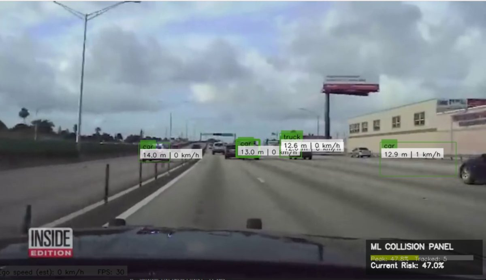
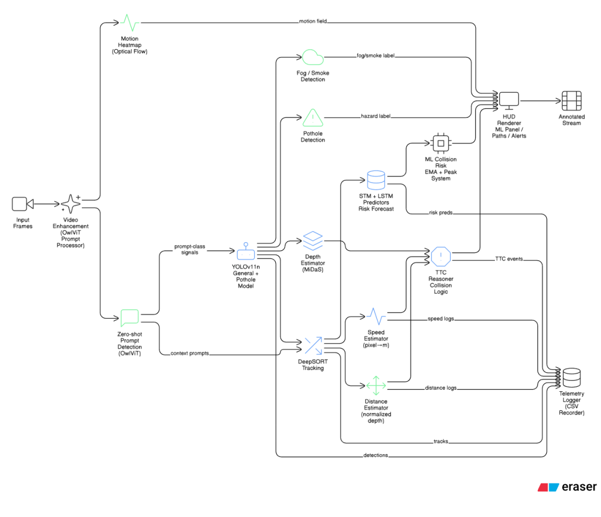
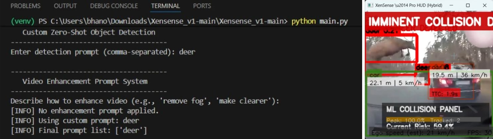
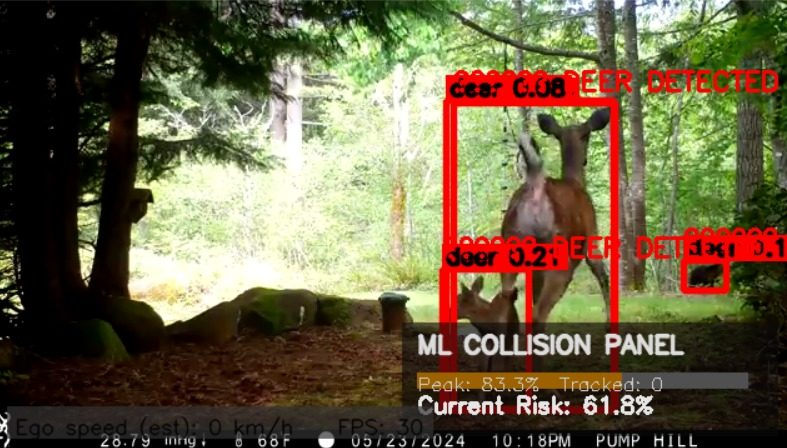
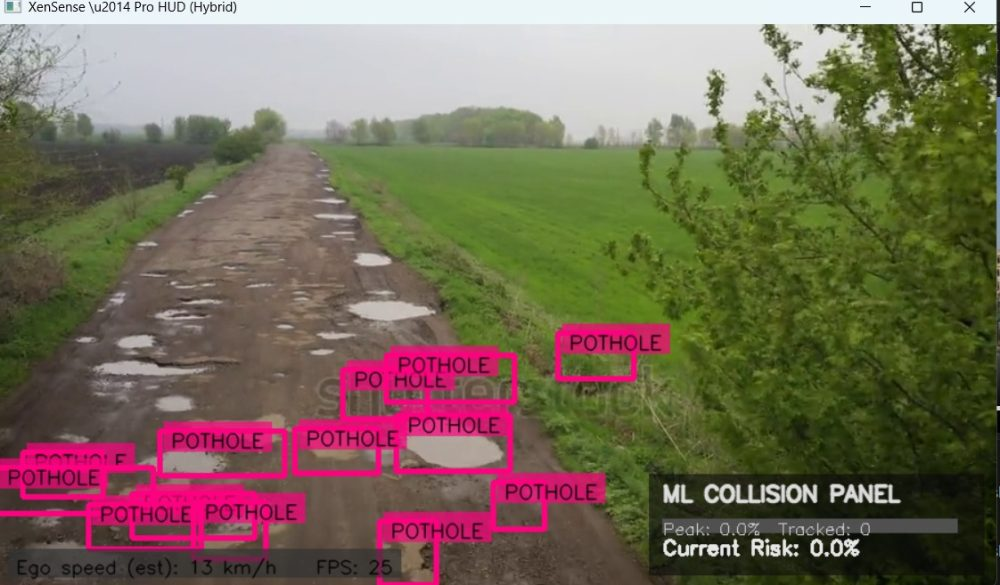
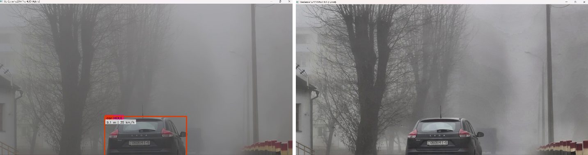
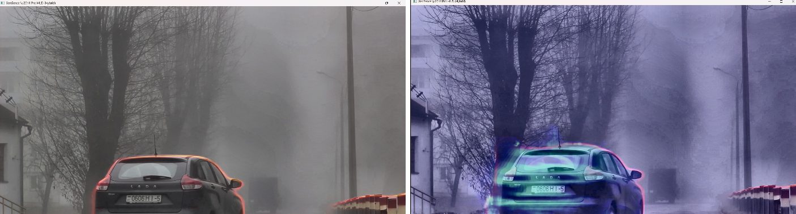
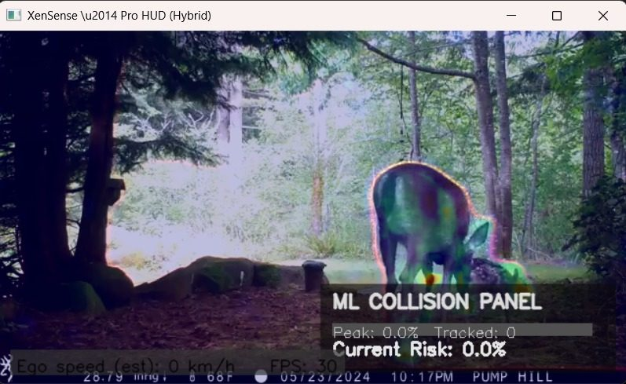

# XenSense-V1

A real-time road-scene perception pipeline that runs on a single camera. It combines object detection, multi-object tracking, monocular depth, zero-shot prompt detection and collision-risk estimation, and shows the results on a live HUD with per-frame CSV telemetry.

<p align="center">
  
</p>

XenSense-V1 is a **research prototype** built as a B.E. major project at BMS College of Engineering, Bengaluru (2025-26). It is not a certified ADAS.

> Paper: *XenSense-V.1: A Survey and Proposed Framework for Video Segmentation and Object Detection in Autonomous Vehicles*, 4th World Conference on Information Systems for Business Management (ISBM 2025), Bangkok, Sept 2025.

---

## Pipeline

```
video frame
  -> optional enhancement (dehaze / sharpen / brightness, prompt-driven)
  -> OwlViT zero-shot detection (every 10th frame, only if a prompt is given)
  -> YOLO11n general detection  (+ optional custom pothole YOLO model)
  -> DeepSort tracking (stable IDs, box smoothing, track retention)
  -> MiDaS-small depth (every N frames, cached in between)
  -> speed / distance / TTC estimation (EMA smoothed)
  -> risk fusion: TTC + STM heuristic predictor + LSTM head + prompt hits
  -> HUD overlay, warning banners, CSV telemetry
```

<p align="center">
  
</p>

---

## Demo

**Zero-shot prompt detection.** Type a prompt at startup (here `deer`) and OwlViT finds it with no retraining. The HUD shows distance, speed, TTC and a collision banner.

<p align="center">
  
</p>

**Animal detection** (YOLO + OwlViT) and **pothole detection** (custom YOLO model):

<p align="center">
  
  
</p>

**Fog.** Without enhancement (left) and with enhancement (right):

<p align="center">
  
</p>

**Depth and motion.** MiDaS depth map and depth-gradient view (top), optical-flow motion heatmap (bottom):

<p align="center">
  
  
</p>

| Module | File |
|---|---|
| Main loop, HUD, risk fusion, hotkeys | `main.py` |
| YOLO general + pothole detector | `detector.py` |
| DeepSort tracker | `tracker/` |
| MiDaS depth wrapper | `depth_estimator.py` |
| Speed estimation | `speed_estimator.py` |
| STM trajectory / risk heuristic | `stm_predictor.py` |
| LSTM risk head | `stm_lstm_predictor.py` |
| OwlViT prompt detection | `prompt_detector.py` |
| Video enhancement | `video_prompt_processor.py`, `smoke_removal.py` |
| Telemetry evaluation | `evaluate.py`, `analyze_performance.py` |
| Settings | `config.yaml`, `prompt_profiles.json` |

---

## Setup

Tested with Python 3.9+. A CUDA GPU is strongly recommended. CPU works but is slow.

```bash
git clone https://github.com/poenitens-42/Xensense_v1.git
cd Xensense_v1

python -m venv venv
source venv/bin/activate            # Windows: venv\Scripts\activate

# Install PyTorch for your CUDA version first: https://pytorch.org/get-started/locally/
pip install -r requirements.txt
pip install transformers            # needed for OwlViT (prompt detection)
pip install pandas matplotlib scikit-learn   # only for evaluate.py / analyze_performance.py
```

### Model weights

| Model | How you get it |
|---|---|
| `yolo11n.pt` | Downloaded automatically by Ultralytics on first run |
| MiDaS-small | Downloaded automatically via `torch.hub` on first run |
| OwlViT (`google/owlvit-base-patch32`) | Downloaded automatically from Hugging Face on first run |
| `models/best.pt` (pothole model) | **Not included in this repo.** Place your trained YOLO pothole weights at `models/best.pt` |

If you do not have `models/best.pt`, the program will currently fail at startup. Until a fallback is added, either add the weights or point `detector.pothole_model` in `config.yaml` to any valid YOLO `.pt` file and leave pothole detection off.

---

## Running

```bash
mkdir -p data      # put your input videos here
python main.py
```

The program asks for, in order:

1. **Video path** (skipped if `video_path` is set in `config.yaml`)
2. **Smoke enhancement** `y/n`
3. **Detection prompt**, comma-separated, e.g. `deer, cow, fallen tree`. Press Enter to disable OwlViT.
4. **Enhancement prompt**, e.g. `remove fog`, `make clearer`, `brighter`. Press Enter to skip.

A window titled *XenSense - Pro HUD* opens. Telemetry is written to `logs/session_<timestamp>.csv`.

### Hotkeys (focus the video window)

| Key | Action |
|---|---|
| `h` | Show help / pause |
| `q` | Quit |
| `d` | Toggle dehaze |
| `v` | Toggle prompt-based video enhancement |
| `o` | Toggle OwlViT prompt detection |
| `t` | Enter new detection prompts (in terminal) |
| `u` | Voice prompt update (needs `SpeechRecognition` + microphone) |
| `l` / `s` | Load / save a prompt profile (`prompt_profiles.json`) |
| `m` | Toggle motion heatmap (optical flow) |
| `n` | Toggle depth-gradient heatmap |
| `p` | Pothole detection (see known issues) |

Built-in prompt profiles: `wildlife`, `city`, `highway`.

---

## Configuration

Key settings in `config.yaml`:

| Key | Meaning |
|---|---|
| `detector.conf_thresh` | YOLO confidence threshold |
| `detector.allowed_classes` | Classes kept from YOLO |
| `detector.detect_every_n` | Run YOLO every N frames (1 = every frame) |
| `tracker.max_age`, `tracker.n_init` | DeepSort track lifetime / confirmation |
| `speed.fps` | **Set this to your video's real FPS**, speeds scale with it |
| `speed.pixel_to_meter` | Fallback pixel-to-metre factor |
| `reasoner.ttc_warn_s` | TTC threshold for warnings |
| `depth.resize` | MiDaS input size |

---

## Telemetry and evaluation

Each row of the CSV logs: `timestamp, frame, track_id, source, class, dist_m, speed_kmh, TTC_s, ml_risk, stm_risk, global_risk, crash_side, x, y, w, h`.

```bash
python evaluate.py logs/session_<timestamp>.csv --outdir results
python analyze_performance.py      # plots the latest log in logs/
```

---

## Performance

FPS measured on the development machine (mid-range NVIDIA GPU) as reported in the project report:

| Configuration | FPS |
|---|---|
| Detection only | 32-38 |
| Detection + tracking | 28-32 |
| + depth + STM | 20-25 |
| + heatmaps | 16-20 |
| + OwlViT prompt detection | 14-17 |

Numbers depend heavily on GPU, input resolution and enabled modules.

---

## Limitations and known issues

Please read this before relying on any output.

- **Distances and speeds are approximate.** MiDaS gives *relative* depth, and pixel-to-metre conversion uses class-size heuristics. Treat `dist_m`, `speed_kmh` and `TTC_s` as rough relative indicators, not calibrated measurements.
- **The LSTM risk head is not trained.** `stm_lstm_predictor.py` defines the network but no trained weights are loaded, so its output is not meaningful yet. The STM heuristic and TTC carry the risk signal.
- **Detection only, no segmentation masks.** YOLO is used for bounding boxes; masks are not used downstream.
- **No quantitative accuracy benchmarks yet** (e.g. mAP, MOTA/IDF1, distance error on KITTI). Results so far are qualitative.
- Designed for **forward-facing dashcam footage**. Fixed CCTV-style views will produce misleading TTC and lane logic.
- `models/best.pt` is missing from the repo (see Setup).
- `transformers` is not yet in `requirements.txt`.
- The `p` hotkey re-reads the config value instead of toggling.
- If video enhancement is on, the last frame of a video can be `None` and may crash the loop at end of video.

### Roadmap

- Train the LSTM risk head on logged telemetry and load its weights
- Graceful fallback when the pothole model is missing
- Read FPS from the video automatically
- Camera calibration for metric distance
- Quantitative evaluation on KITTI / BDD100K

---

## Tech stack

Python, PyTorch, Ultralytics YOLO11, DeepSort, MiDaS, Hugging Face Transformers (OwlViT), OpenCV, NumPy, SciPy.
